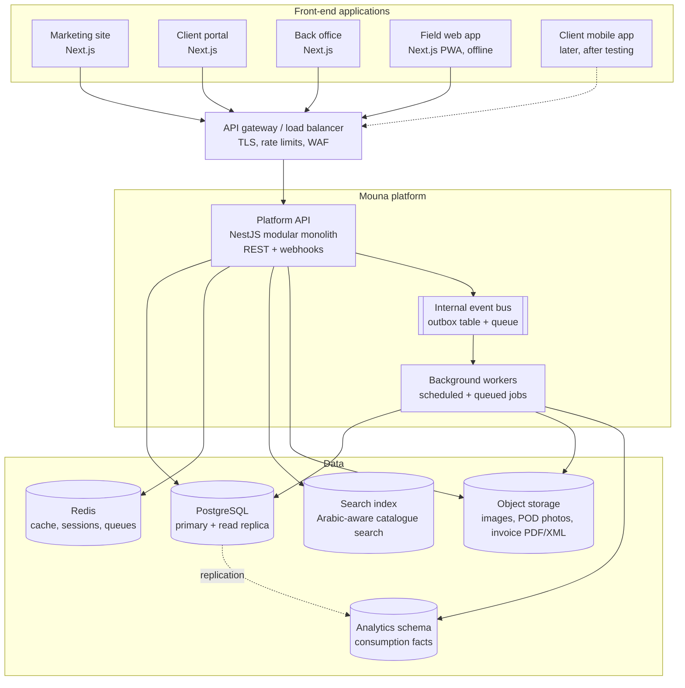
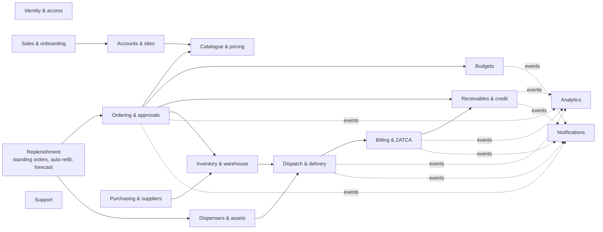

# 01 · System architecture

## 1. Guiding principles

1. **Site-centred, not cart-centred.** Every order, delivery, dispenser, budget and consumption figure belongs to a client *site*. That is what makes "always stocked" and per-employee analytics possible.
2. **One backend, clear modules.** A modular monolith: one deployable API with strict internal boundaries. A small team ships faster than with microservices, and any module can be split out later if load requires it.
3. **Arabic first, English equal.** Right-to-left layout is the default, not an afterthought. Every text field that a client sees (product names, units, notifications, invoices) is stored in both languages.
4. **Money and stock are never edited, only recorded.** Stock levels, invoices, payments and credit balances come from append-only ledgers. Corrections are new entries (adjustments, credit notes), never overwrites. This is what makes audits and ZATCA compliance survivable.
5. **Every important action is an event.** "Order approved", "delivery completed", "invoice cleared" are published inside the system. Notifications, analytics and budgets react to events instead of being wired into each screen.
6. **Data stays in Saudi Arabia.** Hosting, backups and logs stay in-kingdom (PDPL), with personal data kept to what operations need.

## 2. Applications

| Application | Users | Form | Purpose |
|---|---|---|---|
| **Marketing website** — `mouna.sa` | Prospects | Web (server-rendered for SEO) | Explain the offer, show categories and the free-dispenser model, capture leads and self sign-up |
| **Client portal** — `app.mouna.sa` | All client roles | Web, desktop and mobile browser | Ordering, approvals, standing orders, budgets, deliveries, invoices, statements, analytics, company settings |
| **Back office** — `ops.mouna.sa` | Mouna staff | Web | Sales pipeline, onboarding, credit, catalogue and pricing, purchasing, inventory, dispatch, dispensers, billing, collections, support |
| **Field web app** — `field.mouna.sa` | Drivers, technicians | Installable web app (PWA) on company Android phones; works offline | Route of the day, loading checklist, proof of delivery, returns, dispenser install and service jobs |
| *Client mobile app (later)* | Requesters, approvers, receivers | iOS + Android, built after the web portal has been tested with real clients | Quick requests, one-tap approvals, delivery tracking. A light subset of the portal |

**Web first (decided 19 Nov 2026).** At launch everything runs in the browser. The client portal is fully usable on a phone browser, so approvers and receivers can work from the WhatsApp/SMS links they receive. The only operations tool that runs on phones is the field web app, and it is still a web app: installed to the home screen, it works offline, uses the camera for barcodes and photos, and uses GPS. Warehouse staff use the back office in the browser with handheld barcode scanners that type into the page like a keyboard. A native client app is built only after the portal has been tested with real clients, using what they actually do on their phones.

If field testing shows the web app is not reliable enough offline (for example on older phones or in long dead zones), the field app can be rebuilt as a native Android app against the same API without changing anything else.

## 3. Container view

## 4. Backend modules

Each module owns its own database schema. Modules talk to each other only through their public service interface or through events; no module reads another module's tables.

| Module | Owns | Key rules |
|---|---|---|
| **Identity & access** | Users, logins, sessions, roles, API keys | Email or phone + one-time code; password optional; 2FA mandatory for Mouna staff and client Finance/Admin; SSO (Microsoft / Google) for large clients |
| **Accounts & sites** | Client companies, legal entities (CRs), billing accounts, sites, departments, cost centres, headcount | A company can have several CRs; each site belongs to one billing account; headcount is kept per site with history (needed for cost per employee) |
| **Catalogue & pricing** | Master products and variants, units (piece/pack/carton), categories, price lists, client contracts, approved catalogues | Price = client contract price → client tier price → list price; VAT 15% shown separately; Phase 2 categories hidden until launched |
| **Ordering & approvals** | Requests, carts, orders, order lines, approval rules and decisions | Requests become orders only after approval; approval rules by amount, category, budget status, requester; credit check before confirmation |
| **Budgets** | Budgets per cost centre / site / department / project and period; commitments; actuals | Commit at approval, convert to actual at delivery, release on cancel; alerts at 80% and 100%; at 100% either block or escalate (client setting) |
| **Replenishment** | Standing orders, refill plans, consumption forecasts, days-of-cover | Generates draft orders before each delivery slot; uses dispensers × headcount × usage rate, then corrects with history |
| **Inventory & warehouse** | Warehouses, locations/bins, stock ledger, lots and expiry, reservations, cycle counts | Stock is a ledger of movements; reserve on order confirmation; FEFO picking for items with expiry (kitchen consumables) |
| **Purchasing & suppliers** | Suppliers, supplier price lists, purchase orders, goods receipts, supplier invoices | Reorder suggestions from forecast; three-way match (PO / receipt / supplier invoice) before payment |
| **Dispatch & delivery** | Delivery zones, routes, delivery slots, vehicles, drivers, trips, stops, proof of delivery, returns | Each site has a fixed weekly slot; orders cut off 24h before; route optimisation per day; partial delivery creates a backorder |
| **Dispensers & assets** | Dispenser models, serial-numbered units, installations per site, service jobs, refill compatibility | A dispenser defines which refills the site can order; removal on churn is a tracked job |
| **Billing & ZATCA** | Delivery notes, invoices (monthly summary and single), credit notes, ZATCA submission records, invoice counter and hash chain | One monthly invoice per billing account; delivered lines only; clearance with ZATCA before the invoice is sent to the client |
| **Receivables & credit** | Credit applications, credit limits, customer ledger, payments, allocations, statements, dunning, credit holds | Available credit = limit − open invoices − uninvoiced deliveries − confirmed orders; hold blocks new orders, not deliveries already loaded |
| **Accounting export** | Account mapping (product category → revenue/COGS accounts, VAT codes), daily journal batches, export log | No general ledger in the platform. Each day's invoices, credit notes, purchases, stock movements and payments become balanced journal entries for the accounting package; a batch is never changed after export, corrections go in the next batch |
| **Analytics** | Consumption facts, KPIs, anomaly flags, premium entitlements | Built from events into a reporting schema; never queries live transactional tables from dashboards |
| **Sales & onboarding** | Leads, opportunities, site surveys, sales rep targets, contracts | Field reps work from the back office on a tablet; lead → client conversion creates the company, sites and credit application |
| **Support** | Tickets, complaints, delivery issues, returns requests | Linked to an order, delivery or dispenser; SLA timers |
| **Notifications** | Templates (AR/EN), channels, user preferences, delivery log | WhatsApp, SMS and email at launch (no client app yet); approvals delivered as WhatsApp links that open the request in the phone browser; app push added with the client app |

Cross-cutting: **audit log** (who changed what, when, from where) on every module; **file service** for images, PDFs and photos; **settings** per client company.

## 5. Technology choices (proposed)

| Layer | Choice | Why |
|---|---|---|
| Language | TypeScript everywhere | One language for web, mobile and backend; shared types and validation between front and back |
| Web apps | Next.js (React) + Tailwind, with RTL support | Server rendering for the marketing site, fast dashboards for portal and back office; mature RTL tooling |
| Field web app | Next.js as an installable PWA: service worker for offline use, IndexedDB queue for POD and scans, camera barcode scanning, GPS | No app store, one codebase with the other web apps, updates instantly |
| Client mobile app (later) | React Native with Expo | One codebase for iOS and Android; reuses the API, types and design tokens of the web apps |
| Backend | NestJS (Node.js) modular monolith | Clear module structure, dependency injection, good fit for a team that also writes React |
| Database | PostgreSQL 16 | Relational integrity for money and stock; row-level security per client company; JSON where needed |
| Cache and queues | Redis + BullMQ | Sessions, rate limiting, background jobs and schedules |
| Event bus | Transactional outbox table → queue | Guarantees an event is published only if its database change was saved; no extra infrastructure at launch |
| Search | Meilisearch or OpenSearch with Arabic normalisation | Arabic product search (diacritics, ة/ه, أ/ا, plural forms) is poor in plain database search |
| Files | S3-compatible object storage in-kingdom | Product images, proof-of-delivery photos, signed invoice PDFs and XML |
| Analytics | Reporting schema in PostgreSQL at launch; a column store (e.g. ClickHouse) once data grows | Simple first; the event design allows moving later without changing the apps |
| Infrastructure | Containers on a managed Kubernetes or container service; infrastructure as code (Terraform) | Repeatable environments: development, staging, production |
| Observability | OpenTelemetry → logs, metrics, traces; error tracking (e.g. Sentry); uptime checks | Find problems before clients do |
| Repository | One monorepo (Turborepo / Nx): `apps/` for the four web apps + API (client mobile app added later), `packages/` for shared UI, types, i18n, domain rules | One place, shared code, consistent releases |

## 6. Hosting and data residency

- Host in a **cloud region inside Saudi Arabia**. Candidates: Google Cloud (Dammam), Oracle Cloud (Riyadh / Jeddah), STC Cloud, or another provider with a KSA region. Choose on: managed PostgreSQL, managed Kubernetes/containers, object storage, and in-kingdom backups. *To confirm with each provider at time of signing.*
- Three environments: **development**, **staging** (copy of production structure, test ZATCA sandbox), **production**.
- Backups: database point-in-time recovery for 30 days; daily snapshots kept 1 year; invoice records kept at least as long as KSA tax law requires (currently 6 years — confirm with tax advisor).
- Targets: 99.5% availability in business hours for the portal; recovery point ≤ 15 minutes; recovery time ≤ 4 hours.

## 7. External integrations

| Integration | Used for | Notes |
|---|---|---|
| **ZATCA Fatoora (Phase 2)** | Clearing B2B tax invoices and credit notes before sending them to clients | UBL 2.1 XML, cryptographic stamp, QR code, invoice hash chain, device (EGS) onboarding and certificates. Sandbox for testing. Confirm Mouna's integration wave with the tax advisor |
| **Wathq** | Commercial Registration lookup at client onboarding | Confirms the company exists, its CR, owners and status |
| **SIMAH (commercial)** | Credit reports for credit limit decisions | Contract needed; manual upload acceptable at launch |
| **National Address (SPL)** | Validating and geocoding site addresses | Short address code for each site |
| **Maps and routing** | Geocoding, route optimisation, live van location | Google Maps Platform or an open-source router (VROOM / OSRM) |
| **Bank** | Virtual IBAN per client for automatic payment matching; bank statement import | Ask the bank about virtual account / collection services |
| **SADAD** | Bill payment by clients' finance teams | Through the bank or a biller aggregator |
| **Card gateway** | mada, Visa/Mastercard, Apple Pay for small or new clients | Local gateway (e.g. Moyasar, HyperPay, Tap, PayTabs) — to choose |
| **SMS / WhatsApp** | One-time codes, approval requests, delivery alerts | Local SMS provider with registered sender ID; WhatsApp Business API |
| **Email and push** | Invoices, statements, reports; later, mobile notifications | Transactional email service at launch; Firebase / APNs when the client app arrives |
| **Mouna's accounting package** | General ledger, payroll, VAT returns, supplier payments | Daily export of journal entries: invoices and credit notes (revenue, VAT output), purchases (VAT input), stock movements at cost (COGS, inventory value), payments received. Each entry carries the platform document number so accountants can trace it back. API if the chosen package has one; file import otherwise. Package not chosen yet (candidates: Odoo Accounting, Zoho Books, Qoyod, Daftra, SAP Business One) |
| **Client ERPs (later)** | Sending invoices and orders into SAP, Oracle, Odoo, Microsoft Dynamics | Through a public API and webhooks; CSV/Excel export at launch |

## 8. Security

- Each client company's data is separated by a `company_id` on every row, enforced by PostgreSQL row-level security as a second line behind the application check.
- Encryption in transit (TLS 1.2+) and at rest (database, storage, backups).
- Role-based access with per-site and per-cost-centre scope (see [03](03-roles-and-permissions.md)).
- 2FA for all Mouna staff and for client Admin and Finance roles.
- ZATCA private keys and certificates in a managed secret store / key management service, never in code or the database in plain form.
- Audit log is append-only and kept 6 years.
- Annual penetration test; dependency scanning in the build pipeline. Align with the NCA Essential Cybersecurity Controls where practical — large or government-linked clients will ask.

## 9. Scale assumptions

Design load for Year 5 of the model: about 3,000 client companies, ~6,000 sites, ~60,000 client users, ~25,000 orders a month, ~1,500 SKUs, a few hundred deliveries a day. This is modest load; one well-sized PostgreSQL server with a read replica handles it. The architecture is shaped by **correctness** (money, stock, tax) and **operations** (routes, approvals), not by traffic.
