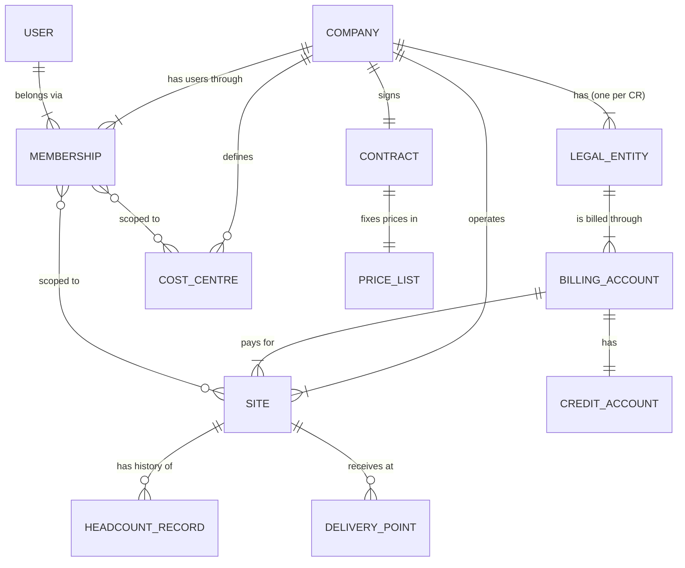
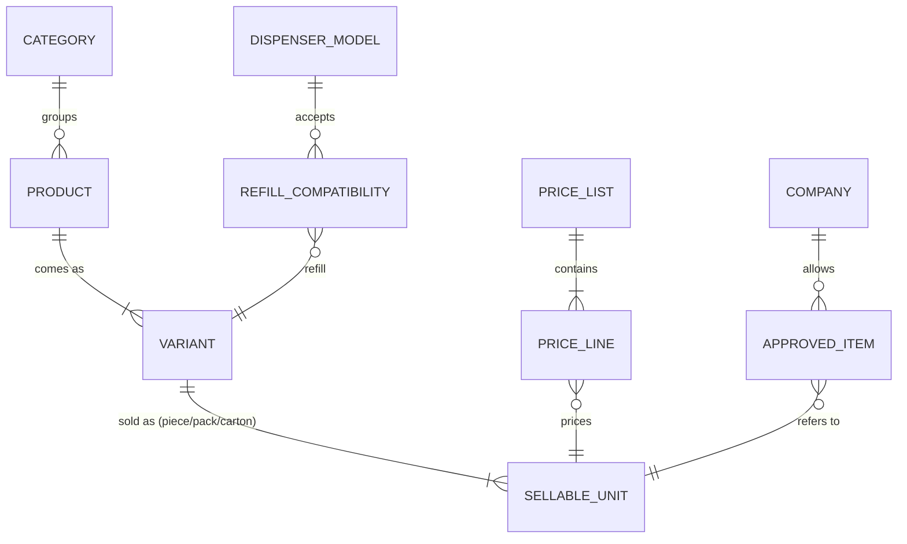
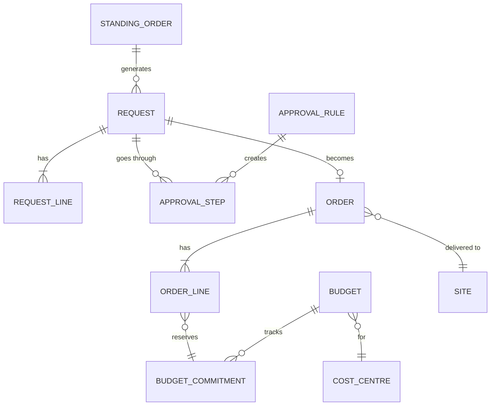
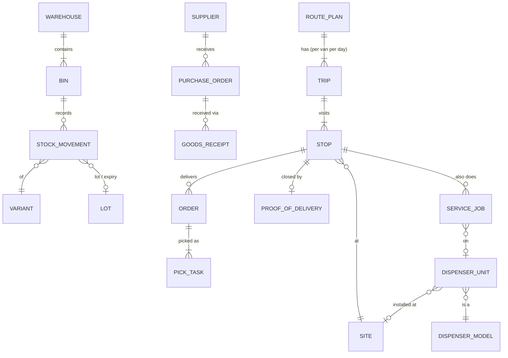
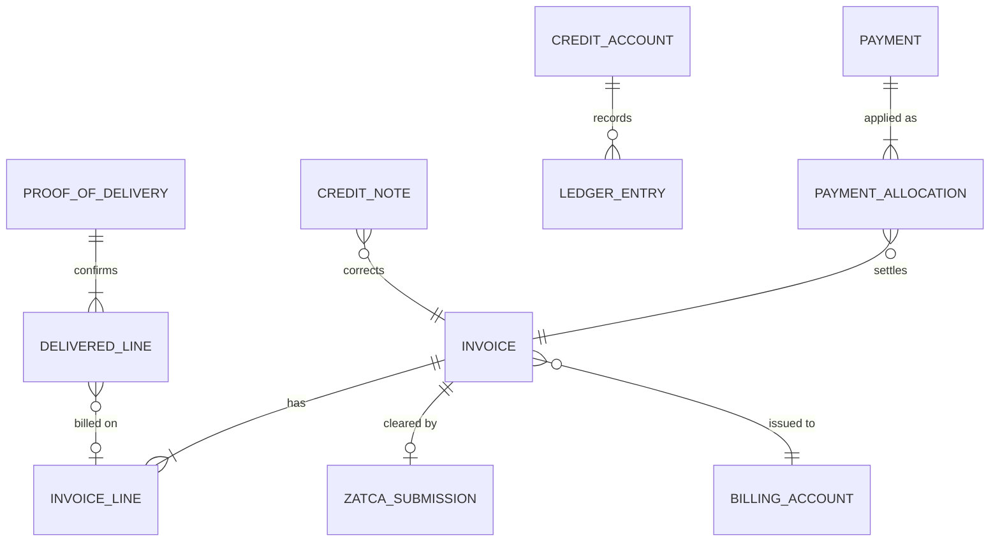

# 02 · Domain model

The main business objects, grouped by module. Field lists are the essential ones, not the full schema.

## 1. Client structure

| Object | Meaning | Key fields |
|---|---|---|
| **Company** | The client as Mouna sees it (one relationship, one account manager) | name AR/EN, segment, size band, status (prospect, onboarding, active, on hold, churned), account manager, premium tier |
| **Legal entity** | A Commercial Registration under the company. A group may have several | CR number, VAT number, legal name AR/EN, national address — all printed on the ZATCA invoice |
| **Billing account** | Who receives and pays the monthly invoice | legal entity, invoice email(s), payment terms (e.g. 45 days), PO required (yes/no), invoice grouping (per account / per site) |
| **Site** | A physical office, branch or floor that receives deliveries | address + National Address short code, geo point, delivery zone, weekly delivery slot, receiving hours, access notes, headcount |
| **Headcount record** | Number of employees at a site from a date | site, count, effective date, source (client / sales survey) |
| **Cost centre** | Department, project or any budget holder the client wants | code, name, parent (tree), linked sites |
| **User / membership** | A person, and the role(s) they hold in one company | phone, email, language, role(s), scope (sites, cost centres), approval limit |
| **Contract** | Commercial terms signed with the client | start/end, price list, delivery frequency, dispenser terms (free on loan, minimum refill spend), notice period |

## 2. Catalogue and pricing

- **Product → variant → sellable unit.** "Hand towel, Z-fold" → "2-ply white, 200 sheets" → "pack of 20" / "carton of 5 packs". Stock is held in the base unit; sellable units convert.
- **Price list.** Mouna list price, tier price lists (by size band), and a client-specific list from the contract. Each line: unit, price excl. VAT, valid from/to, minimum quantity.
- **Approved catalogue.** The subset of products a client's employees can see and request. Empty = whole catalogue.
- **Refill compatibility.** Which refills fit which dispenser model. A site with Mouna dispensers sees the matching refills first and can be restricted to them.
- **Category phase flag.** Phase 2 categories (paper, toner, stationery, filing, IT) exist in the catalogue but stay hidden until switched on — per client if needed for pilots.

## 3. Ordering, approvals and budgets

| Object | Meaning |
|---|---|
| **Request** | What an employee (or the replenishment engine) asks for. Has a site, cost centre, optional client PO number, notes |
| **Approval rule** | Client-defined: "requests over SAR 2,000 need the site manager", "any kitchen item over budget needs Finance", "standing orders within budget auto-approve" |
| **Approval step** | One decision in the chain: approver, decision, time, comment. Approvers can edit quantities before approving |
| **Order** | An approved request that Mouna commits to deliver. One order = one site + one delivery date |
| **Standing order** | A recurring template per site: items, quantities, frequency (every slot / every 2nd slot / monthly), auto-adjust on/off |
| **Budget** | Amount per cost centre (or site / project) per period (month, quarter, year), with rollover rule and hard/soft limit |
| **Budget commitment** | Money reserved at approval, converted to actual at delivery, released on cancellation |

## 4. Operations

- **Stock movement** is the only way stock changes: receipt, putaway, reservation, pick, dispatch, return, adjustment, count variance, write-off. On-hand and available stock are computed from it.
- **Lot** carries expiry for items such as coffee, milk powder, sugar sachets, cleaning chemicals. Picking is first-expiry-first-out.
- **Trip / stop.** A van's day is a trip; each site visited is a stop. One stop can deliver several orders and carry out service jobs at the same time.
- **Proof of delivery.** Receiver name, signature or one-time code, photo, delivered quantities per line, shortages, damages, time and GPS.
- **Dispenser unit.** Serial-numbered, owned by Mouna, on loan to the client. Status: in stock, installed, needs service, removed, written off.
- **Service job.** Install, refill-and-check, repair, swap, remove. Done by a technician or a driver with the right skill.

## 5. Money

- **Delivered line** — what the client actually received and signed for. Only delivered lines are billed.
- **Invoice** — normally the monthly summary invoice per billing account. Single invoices for card-paying clients and one-off sales. Carries the ZATCA sequence number, invoice hash, previous-invoice hash, QR code and cleared XML.
- **ZATCA submission** — request, response, status (cleared / rejected / warnings), retry history.
- **Credit note** — returns, damages, price corrections; also cleared with ZATCA and linked to the original invoice.
- **Credit account and ledger** — limit, terms, and every charge, payment, credit note and write-off as ledger entries. Balance and ageing come from the ledger.
- **Payment** — bank transfer (matched from the uploaded bank statement by invoice reference, amount and client) or card through Stripe. One payment can settle several invoices.
- **Bank statement line** — imported from the bank's CSV/Excel; status unmatched / suggested / matched / ignored, so no transfer is counted twice.

## 6. Analytics facts

Built from events, refreshed nightly (and on demand for the current month).

| Fact table | Grain | Feeds |
|---|---|---|
| `consumption_daily` | site × SKU × day (delivered quantity and value) | Trends, spikes, forecast |
| `spend_monthly` | company × site × cost centre × category × month | Spend by branch / department, budget vs actual |
| `per_employee_monthly` | site × month (spend ÷ average headcount) | Cost per employee — the headline client KPI |
| `order_cycle` | order (request → approval → delivery times) | Approval delays, service level |
| `dispenser_utilisation` | dispenser unit × month (refills delivered vs expected) | Leakage: dispensers being filled with non-Mouna refills |
| `client_health` | company × month (spend vs contract, complaints, late payments) | Churn risk for account managers |
