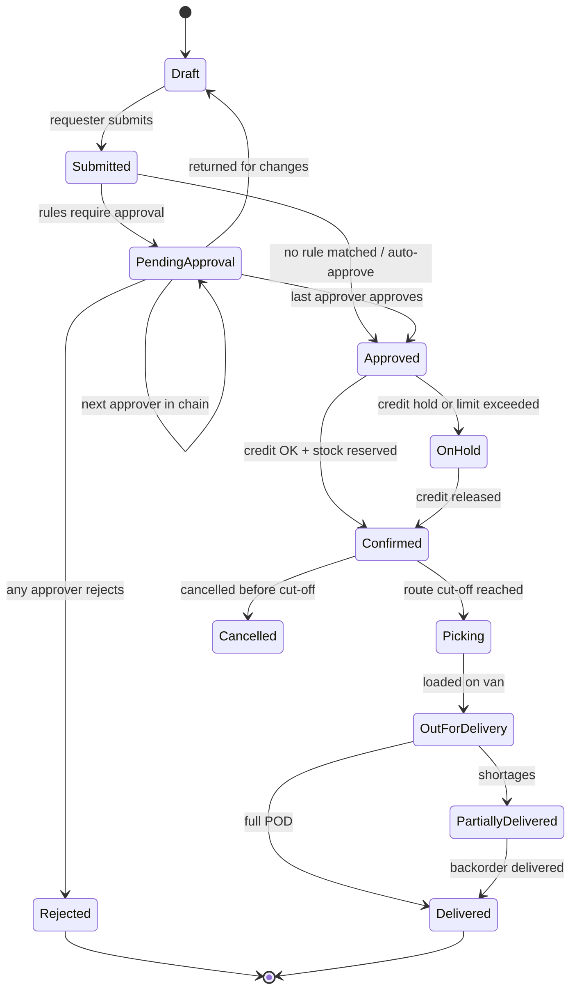
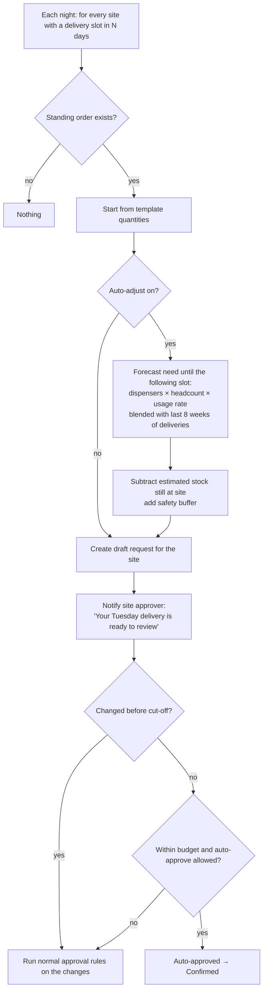
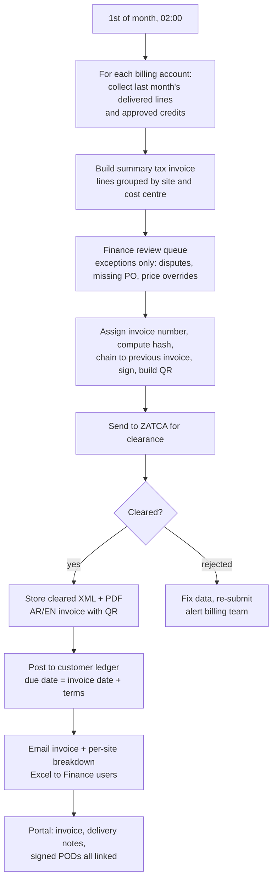
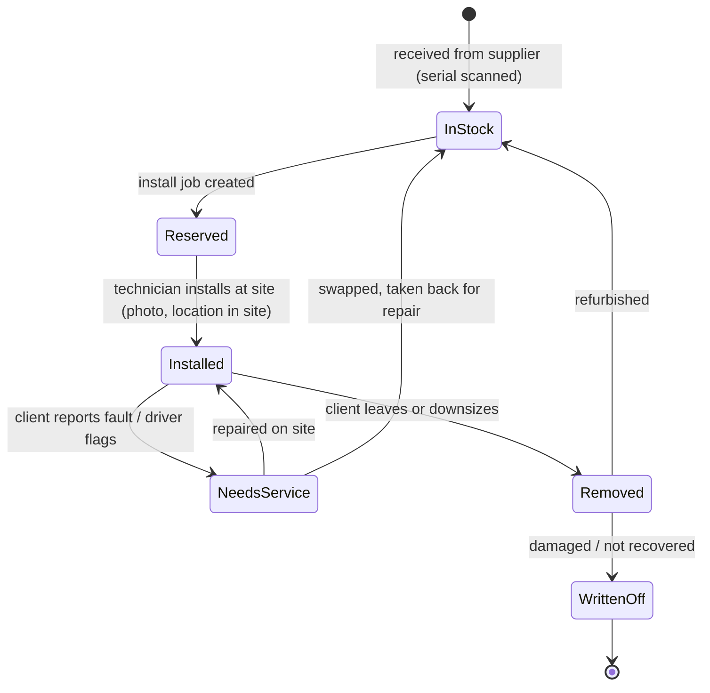

# 04 · Business flows

Ten flows run the business. Each lists the trigger, the steps, the system rules, and what happens when things go wrong.

1. [Client onboarding](#1-client-onboarding)
2. [Request → approval → order](#2-request--approval--order)
3. [Standing orders and automatic refills](#3-standing-orders-and-automatic-refills)
4. [Budget control](#4-budget-control)
5. [Warehouse and delivery](#5-warehouse-and-delivery)
6. [Monthly billing and ZATCA](#6-monthly-billing-and-zatca)
7. [Collections and credit control](#7-collections-and-credit-control)
8. [Dispenser lifecycle](#8-dispenser-lifecycle)
9. [Purchasing and replenishment of Mouna stock](#9-purchasing-and-replenishment-of-mouna-stock)
10. [Returns and complaints](#10-returns-and-complaints)

---

## 1. Client onboarding

**Trigger:** a field sales rep signs a prospect, or a company signs up on the website.

```mermaid
sequenceDiagram
    autonumber
    participant P as Prospect
    participant R as Sales rep (back office)
    participant S as Platform
    participant W as Wathq
    participant C as Credit controller
    participant T as Technician

    P->>S: Website sign-up or rep creates lead
    R->>S: Qualify: employees, sites, current supplier, monthly spend
    R->>S: Enter CR number
    S->>W: Look up CR
    W-->>S: Legal name, status, address
    R->>S: Site survey per site (headcount, washrooms, kitchens, dispenser needs, photos)
    S->>S: Propose dispensers and starter standing order from survey
    R->>S: Build quote from tier price list (discount within limit)
    P->>S: Accept quote and contract (e-signature), submit credit application
    S->>C: Credit review task
    C->>S: Approve limit and terms (or card-only)
    S->>T: Create dispenser install jobs on site's first delivery slot
    S->>P: Invite company admin; admin invites users, sets approvers and budgets
    T->>S: Dispensers installed (serials scanned) → site active
    S->>S: First standing order generated for next slot
```

**Rules**
- A company cannot order on credit until the credit controller approves a limit. Until then it can order with card payment.
- Starter standing order = survey headcount × SAR-per-employee benchmark per category, split into SKUs matching the installed dispensers. The client admin reviews it before the first delivery.
- Self sign-ups from the website (small companies, under 50 employees) go straight to card payment, no dispenser programme unless sales qualifies them.

**Exceptions:** CR inactive → stop. Credit refused → card-only account. Site outside a delivery zone → waitlist and inform sales.

---

## 2. Request → approval → order



**Steps**
1. Requester picks items from the approved catalogue for their site and cost centre. The cart shows the budget remaining in that cost centre.
2. On submit, the rules engine evaluates approval rules in order. A rule has conditions (amount, category, cost centre, requester role, budget status, item not in standing order) and an outcome (approver role or named person, number of levels, auto-approve).
3. Each approver gets a WhatsApp / email notification with a link that opens the request in the portal (phone or desktop). Approve in one tap; edit quantities; reject with reason; return to requester.
4. Reminders after 24h; escalation to the approver's backup after 48h (client setting). Requests not decided before the delivery cut-off move to the next slot automatically, and the requester is told.
5. On approval, the system: commits the budget, checks available credit, reserves stock, and assigns the order to the site's next delivery slot. Several approved requests for the same site and slot are **merged into one order** (one delivery, one delivery note).
6. Out-of-stock lines: offer an approved substitute (same category, equal or lower price) or backorder. Client setting: "allow substitutes" yes/no.

**Urgent orders:** a client can ask for an extra delivery outside their slot for a fee (setting per contract). Dispatch must accept it.

---

## 3. Standing orders and automatic refills

This is the core of "always stocked".



**Rules**
- N (review window) defaults to 3 days before the slot; cut-off 24 hours before.
- Estimated stock at site = last delivered quantity − expected use since. Receivers can correct it with a quick count in the portal from their phone ("we still have 4 packs"), which improves the forecast.
- Forecast is limited to ±30% of the template unless the approver accepts a bigger change, so one bad week of data cannot double an order.
- Spikes (a week 50% above the 8-week average) are flagged to the client and the account manager, not silently ordered.

---

## 4. Budget control

| Event | Budget effect |
|---|---|
| Request submitted | Shown against budget (preview only) |
| Request approved | **Commitment** created for the order value excl. VAT |
| Order delivered | Commitment becomes **actual** at delivered value |
| Order cancelled or line short | Commitment released |
| Credit note | Actual reduced |

- Alerts to the budget owner and Finance at 80% and 100%.
- At 100% the client chooses: **block** (requests cannot be approved), **escalate** (route to Finance or a named person), or **warn only**.
- Budgets can be set by month, quarter or year, with or without rollover of unused amounts.

---

## 5. Warehouse and delivery

```mermaid
sequenceDiagram
    autonumber
    participant S as Platform
    participant D as Dispatcher
    participant W as Warehouse
    participant V as Driver (field web app)
    participant R as Client receiver

    Note over S: Day before delivery, at cut-off
    S->>S: Lock orders for tomorrow's slots
    S->>D: Proposed routes per zone (optimised by time windows, van capacity)
    D->>S: Adjust and publish route plan
    S->>W: Pick list per trip (batch pick by zone, FEFO lots)
    W->>S: Picked and packed, labelled per stop (scan)
    V->>S: Load check: scan every package onto the van
    S->>R: WhatsApp: "Delivery today 9–11, driver Ahmed"
    V->>S: Arrive at stop (GPS)
    V->>R: Hand over; receiver checks quantities
    R->>V: One-time code or signature
    V->>S: POD: quantities, photo, shortages/damage, also service jobs done
    S->>R: Delivery note in portal
    S->>S: Delivered lines → billing; shortages → backorder; budget actual
```

**Rules**
- Each site has a fixed weekly slot (day + 2-hour window) set at onboarding. Large sites may get two slots a week.
- Field web app works offline; it syncs POD when back online. Every scan and POD has a timestamp and GPS point.
- Failed delivery (site closed, receiver absent): driver records reason + photo; order goes back to the next slot; client is notified. Repeated failures alert the account manager.
- Returns (wrong item, damaged) are collected on the next visit and create a return receipt, then a credit note.

---

## 6. Monthly billing and ZATCA



**Rules**
- Only goods delivered and signed for are invoiced. Every invoice line traces back to a POD.
- The invoice must be issued within the deadline the VAT rules set for summary invoices (to confirm with the tax advisor; currently the 15th of the following month is understood).
- Clients that need it get one invoice **per site** or **per cost centre** instead of one per account (billing account setting).
- If the client requires a PO number, the invoice holds until a PO is entered, with reminders.
- Card-paying clients get a single invoice per delivery instead of the monthly one.

---

## 7. Collections and credit control

**Available credit** = credit limit − unpaid invoices − delivered but not yet invoiced − confirmed orders not yet delivered.

| Days after due date | Action (automatic) |
|---|---|
| −5 | Friendly reminder to Finance users |
| 0 | Due-today notice with payment details (Mouna bank account + invoice number to quote, card payment link) |
| +7 | Reminder + account manager task to call |
| +15 | Warning: orders will be held at +30 |
| +30 | **Credit hold**: new orders cannot be confirmed; standing orders pause; client admin, Finance and account manager notified |
| +60 | Escalation to management; dispenser recovery plan considered |

- Payments arrive by **bank transfer** to Mouna's account or by **card** through Stripe (confirmed instantly by webhook).
- Bank transfers are matched from the daily bank statement that finance uploads: first by invoice number in the transfer reference, then by exact amount + client name; anything left over goes to a "to match" queue for finance. Invoices and reminders always tell the client which reference to quote.
- Unallocated payments go to oldest invoice first unless the client specifies.
- Credit controller can release a hold for a set period with a reason.

---

## 8. Dispenser lifecycle



- Each installed unit records: site, location inside site ("2nd floor, men's washroom"), model, install date.
- Refill compatibility makes the site's catalogue show the right refills first.
- **Leakage check:** if a site's refill deliveries fall far below what its dispensers should use, the account manager is alerted — the client may be buying refills elsewhere. This protects the free-dispenser economics.
- Contract defines what happens on exit: dispensers returned within N days, or charged at a fixed value.

---

## 9. Purchasing and replenishment of Mouna stock

1. Each night, for every SKU: available stock + incoming purchase orders vs. the next 4–6 weeks of forecast demand (sum of all client forecasts + standing orders) + safety stock.
2. Below reorder point → **suggested purchase order** for the supplier with the best agreed price and lead time.
3. Purchasing reviews, edits, sends the PO (email / PDF).
4. Goods receipt at the warehouse: scan against PO, record lots and expiry, quality check, putaway to bins.
5. Supplier invoice entered → three-way match (PO, receipt, invoice). Differences go to a dispute queue; matched invoices are released for payment.
6. Dispenser purchases follow the same flow, with serial numbers captured at receipt.

---

## 10. Returns and complaints

- Client raises an issue from a delivery (wrong item, short, damaged, quality) in portal or app, with photo.
- Support triages: credit only, replace on next delivery, or urgent re-delivery.
- Return collected by driver → return receipt in warehouse (restock or write-off) → credit note (ZATCA-cleared) → applied to the next monthly invoice.
- SLA timers: first response 4 business hours, resolution 2 business days.
