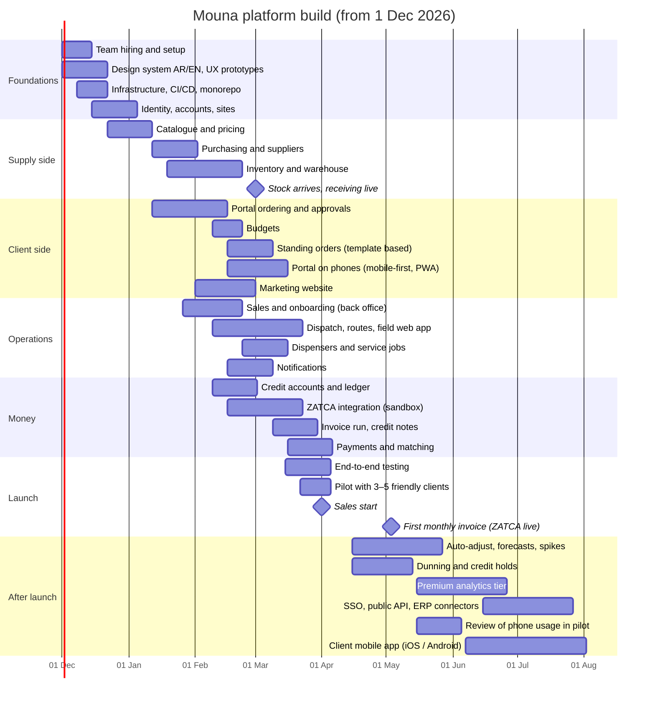

# 06 · Delivery plan and risks

## 1. The honest picture

The decisions are: **fully custom** (including inventory, purchasing, ZATCA invoicing and routing) and the **full feature set** for the sales start in **April 2027**. From 1 December 2026 that is about **18 weeks**.

That is achievable only with a full team in place by mid-December and no big scope changes after January. The good news: several features cannot be useful on day one anyway, because they need data that does not exist yet:

| Feature | Earliest moment it is useful |
|---|---|
| Monthly ZATCA invoice | Early May 2027 (first invoice covers April deliveries) |
| Auto-adjusted standing orders | After ~8 weeks of deliveries per site (June 2027) |
| Spike detection, forecasts | After ~8–12 weeks of history |
| Benchmarks vs similar companies | After a few hundred active clients (late 2027) |
| Dunning and credit holds | First invoices due mid-June 2027 (45-day terms) |

So the plan builds everything, but orders the work so that **what the first client touches is finished first**, and data-dependent features land in the weeks after launch when they first matter. Purchasing and warehouse receiving must be ready **before** launch, because stock has to arrive in March.

## 2. Build sequence

## 3. Team

Estimate for the 18-week build, then reducing to a run-and-improve team:

| Role | Build (Dec–Apr) | After launch |
|---|---|---|
| Product owner / founder's delegate (decides scope daily) | 1 | 1 |
| Tech lead / architect | 1 | 1 |
| Backend engineers | 3 | 2 |
| Web front-end engineers | 2 | 2 |
| Front-end engineer for offline web (field web app, PWA) | 1 | – |
| Mobile engineer (React Native), for the client app after testing | – | 1 |
| UX/UI designer (Arabic-first) | 1 | 0.5 |
| QA engineer | 1 | 1 |
| DevOps / cloud (can be part-time contractor) | 0.5 | 0.5 |
| **Total** | **~10.5** | **~9** |

Going web-first removes the app-store work (two platforms, store reviews, release cycles) from the launch path. That time goes into the portal working well on phones and into the offline field web app.

ZATCA Phase 2 is the one area where outside experience pays for itself: hire or contract one person who has done a ZATCA integration before.

## 4. Risks

| Risk | Impact | Mitigation |
|---|---|---|
| Team not hired by mid-December | Launch slips month for month | Start hiring now; use a contracting firm for the first months while hiring permanent staff |
| Scope grows during build | Launch slips | Freeze launch scope at end of January; changes go to "after launch" unless the founder swaps something out |
| ZATCA integration rejected or late | Cannot issue legal invoices from May | Start sandbox work in February; build compliance tests into CI; fallback: a certified ZATCA e-invoicing provider kept ready as plan B for the first months |
| Warehouse not ready when stock arrives | Launch without stock control | Receiving and stock ledger are scheduled first in the supply track; manual count sheets as fallback for two weeks |
| Field web app unreliable offline on some phones | Lost or late proofs of delivery | Buy one tested Android model for all drivers; test a full route in dead zones during the dry run; fallback is a native Android app on the same API |
| Approvers find the portal on phone too slow without an app | Approvals late | Measure in the pilot; WhatsApp one-tap links reduce the need to open the portal at all; the native app is the planned next step |
| Route optimisation complexity | Wasted van time | Start with fixed zones and manual route order; switch on optimisation once there are enough stops per day |
| Approvers ignore notifications | Orders miss cut-off; "always stocked" fails | WhatsApp channel, one-tap approval, auto-approve for standing orders within budget, escalation to backup |
| Forecasts wrong in early months | Over- or under-delivery | ±30% cap on auto-adjust; receivers' quick counts; account manager review for first 8 weeks |
| Fully custom back office costs more over time than an ERP | Higher running cost, slower new features | Keep modules strictly separated, so accounting or WMS can be replaced by a product later without rewriting the client side |
| Tech team cost not in the financial model | Model understates costs | Check against the model's team plan (31 people in 2027) — see open questions |

## 5. Definition of "ready to launch"

- A pilot client can: be onboarded, have dispensers installed, place and approve an order, receive it with POD, and see it in the portal.
- Stock received, counted and matches the system within 1%.
- Drivers trained, one full week of dry-run routes completed with the field web app, including offline stretches.
- Approve, review-delivery and confirm-delivery tested end to end on iPhone and Android browsers from WhatsApp links.
- ZATCA sandbox: invoices and credit notes clear without errors; production onboarding done.
- Backups restored successfully once from scratch; on-call rota in place.
- Penetration test done on portal and API; critical findings fixed.
