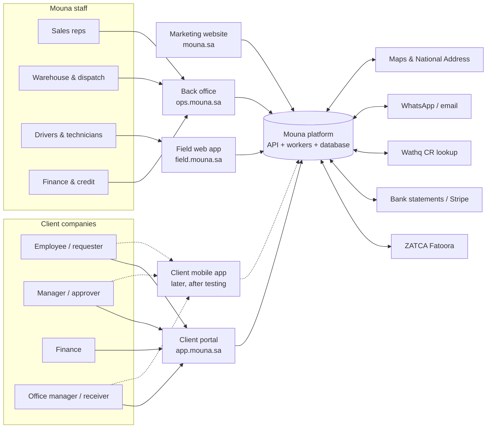

# Mouna platform — architecture

Version 0.1 · 19 Nov 2026 · Status: draft for founder review

This folder describes how the Mouna platform is built: what applications exist, how they fit together, what data they hold, how work flows through them, and what each user sees.

## Documents

| # | Document | What it answers |
|---|---|---|
| 01 | [System architecture](01-system-architecture.md) | Which applications, which modules, which technology, where it runs, how it connects to outside services |
| 02 | [Domain model](02-domain-model.md) | The core business objects and how they relate |
| 03 | [Roles and permissions](03-roles-and-permissions.md) | Who can do what, on the client side and the Mouna side |
| 04 | [Business flows](04-business-flows.md) | Step-by-step flows: onboarding, ordering, approvals, standing orders, delivery, billing, dispensers, purchasing |
| 05 | [User experience](05-user-experience.md) | Site maps and key screens for each application |
| 06 | [Delivery plan and risks](06-delivery-plan.md) | Build order to reach launch in April 2027, team, risks |
| 07 | [Open questions](07-open-questions.md) | Business gaps that still need a founder decision |

## Decisions taken so far

| Topic | Decision | Source |
|---|---|---|
| Payment | Approved companies buy on credit and pay one consolidated monthly invoice by bank transfer (no virtual IBAN or SADAD service). Card payment through Mouna's existing Stripe account for small or new clients and for invoices. | Founder, 19–20 Nov 2026 |
| Messaging | WhatsApp Business (already registered) for sign-in codes and notifications, email as fallback. No SMS at launch. | Founder, 20 Nov 2026 |
| Delivery | Mouna runs its own Riyadh warehouse and its own fleet of vans, drivers and technicians, on fixed weekly routes. | Founder, 19 Nov 2026 |
| Web first | Launch on the web only: marketing site, client portal (mobile-first), back office, and a field web app for drivers and technicians. The client mobile app comes later, after the portal has been tested with real clients. | Founder, 19 Nov 2026 |
| Build | Fully custom: client portal, field web app **and** back office (inventory, purchasing, invoicing, ZATCA) are built in-house. No off-the-shelf ERP. | Founder, 19 Nov 2026 |
| Launch scope | Full feature set from the brief is targeted for the sales start in April 2027. | Founder, 19 Nov 2026 |
| Accounting | General ledger, payroll and VAT returns run in a separate accounting package. The platform sends it daily journal entries. | Founder, 19 Nov 2026 |
| Architecture style | One backend (modular monolith) serving four web applications at launch, and the client app later. | Proposed in 01 |
| Technology | TypeScript end to end; PostgreSQL; hosted in a cloud region inside Saudi Arabia. | Proposed in 01 |

## The platform in one picture

## The idea the architecture is built around

Mouna's promise is "always stocked". The client should not have to think about ordering. So the system's centre is not the shopping cart but the **site**: each client office, with its headcount, its installed dispensers and its consumption history. From those, the platform predicts what the site needs, proposes the next standing order, routes it through the client's approval and budget rules, delivers it on a fixed weekly route, and bills it all on one monthly invoice. Manual ordering exists, but the target is that most volume comes from standing orders and automatic refills.
